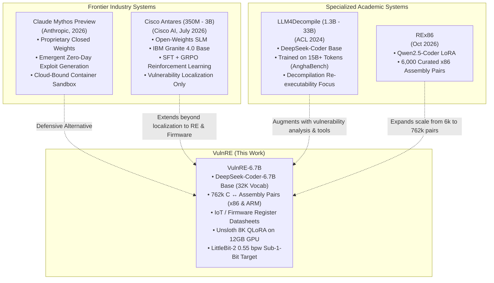

# 🏛️ VulnRE Architecture & Design Specification

> **Version**: 2.0-Production  
> **Target Base**: `deepseek-ai/deepseek-coder-6.7b-base` / `LLM4Binary/llm4decompile-6.7b-v1.5`  
> **Training Paradigm**: Unsloth-Accelerated 4-Bit QLoRA on NVIDIA RTX 3060 12GB  
> **Target Quantization**: Samsung LittleBit-2 Sub-1-Bit (~0.55 bpw) on EVREN H200 Cloud

---

## 1. Executive Vision & Scope

Modern defensive cybersecurity analysis is hindered by two extremes:
1. **Proprietary Frontier Cloud LLMs** (e.g. Claude Sonnet 4.5, GPT-5, Mythos Preview): Highly capable at code reasoning and exploit synthesis, but prohibitive for routine automated repository scanning and disallowed in air-gapped or confidential reverse-engineering environments where proprietary binary code cannot leave internal infrastructure.
2. **Traditional Rule-Based Scanners** (e.g. Ghidra, IDA Pro heuristics, Semgrep, CodeQL): Deterministic and fast, but produce high false-positive rates on semantic edge-cases and struggle to recover readable control-flow logic from stripped assembly.

**VulnRE** bridges this gap. It is an open-weights, locally deployable 6.7-billion parameter language model purpose-built for:
- Low-level vulnerability discovery (C/C++ memory corruption: buffer overflows, use-after-free, integer truncation).
- Assembly-level reverse engineering (decompiling raw x86-64 and ARM assembly into structured, compilable C).
- Microcontroller and IoT firmware security analysis (register-level memory mapping for ESP32, STM32F4, ARM Cortex-M).
- Autonomous agentic tool interaction (operating terminal commands, interpreting compiler errors, web/MCP automation).

---

## 2. Core Architectural Rulings (R1 – R10)

The VulnRE technical blueprint is governed by ten formal architectural decisions:

### R1 — Environment & Reproducibility
- Managed exclusively via `uv` under Python 3.12 (`vulnre/.venv`).
- Fixed core dependencies: `torch==2.14.1+cu130`, `bitsandbytes==0.50.2`, `transformers==4.49.0`, `trl==1.15.0`, `peft==0.21.2`, and `unsloth==2026.10.6`.
- Execution decoupled from interactive shells via `systemd-run --user` units with explicit resource leases.

### R2 — Base Model Selection (The 32K Vocabulary Invariant)
The user explicitly selected two target base candidates:
1. `deepseek-ai/deepseek-coder-6.7b-base`
2. `LLM4Binary/llm4decompile-6.7b-v1.5` (an empirical continuation of DeepSeek-Coder fine-tuned on decompilation).

*Mathematical Justification*:
Both models are based on the **Llama-2 architecture** with a vocabulary size of **32,256 tokens** and separate embedding/LM-head weights (`tie_word_embeddings: false`). 
In post-training extreme quantization (LittleBit-2), the token embedding table and the output language modeling head cannot be binarized; they remain uncompressed FP16 matrices:
$$\text{Fixed FP16 Parameters} = 2 \times (\text{vocab\_size} \times d_{\text{model}}) = 2 \times (32,256 \times 4096) \approx 264.2 \times 10^6 \text{ parameters} \approx \mathbf{0.528 \text{ GB}}$$

In contrast, modern models like Qwen-2.5/Qwen-3 feature a 152,064 vocabulary ($d_{\text{model}}=3584$), imposing a fixed uncompressed floor of:
$$2 \times (152,064 \times 3584 \times 2 \text{ bytes}) \approx \mathbf{2.18 \text{ GB}}$$
Adopting a 152K-vocab model renders achieving a sub-1GB final compressed footprint mathematically impossible regardless of transformer bit-width. Therefore, the 32K vocabulary family is an immutable requirement.

### R3 — Dataset Integrity & Validation
All training corpora were verified against live Hugging Face repositories, replacing legacy uncurated dumps with validated datasets: `bstee615/bigvul`, `bstee615/diversevul`, `starsofchance/CVEfixes_v1.0.8`, `colin/PrimeVul`, and `AlicanKiraz0/Cybersecurity-Dataset-Fenrir-v2.1`.

### R4 — The Two-Stage Training & Quantization Strategy
- **Stage 1 (Local Workstation)**: Supervised Fine-Tuning (SFT) using 4-bit QLoRA on a local NVIDIA GeForce RTX 3060 12GB. Focuses on domain specialization, syntax learning, and agentic workflows.
- **Stage 2 (EVREN Cloud)**: Quantization-Aware Training (QAT) using Samsung LittleBit-2 targeting $\approx 0.55\text{ bpw}$ on NVIDIA H200 141GB enterprise nodes. Local hardware is strictly reserved for Stage 1 fine-tuning and local quantized inference.

### R5 — Version Control & Repository Governance
The codebase is version-controlled via Git, strictly adhering to automated secret scanning, data exclusion boundaries, and comprehensive English documentation.

### R6 — Agentic Tool-Use Execution Scope
The model integrates approximately 44 GB of agentic interaction traces (CLI bash terminals, Playwright MCP tool calling, SWE-rebench workflows). Scope is strictly text, terminal, and HTML structure based; computer vision / desktop GUI automation is explicitly excluded.

### R7 — Compression Thresholds & Multi-Instance Sizing
A model size of $\approx 0.9\text{ GB}$ to $1.2\text{ GB}$ at $0.55\text{ bpw}$ is targeted. On a 12GB workstation GPU, this footprint permits **8 to 10 isolated worker instances** to run in parallel, enabling swarm architectures where independent sub-agents audit separate source files or binary segments concurrently.

### R8 — Context Window & KV Cache Budgeting
The DeepSeek-Coder-6.7B architecture utilizes traditional Multi-Head Attention (MHA) without Grouped-Query Attention (GQA).
At 16,384 tokens in FP16, the Key-Value (KV) cache alone consumes:
$$\text{KV Cache Size} = 2 \times n_{\text{layers}} \times n_{\text{heads}} \times d_{\text{head}} \times \text{seq\_len} \times 2 \text{ bytes}$$
$$= 2 \times 32 \times 32 \times 128 \times 16,384 \times 2 \approx \mathbf{8.59 \text{ GB VRAM}}$$
This would overwhelm a 12GB GPU during generation. 
*Strategic Resolution*:
1. Standard training sequence length is locked at **8,192 tokens** with sequence packing.
2. Inference deployment utilizes 4-bit KV cache quantization (`q4_0`), reducing KV overhead to $\approx 1.0\text{ GB}$ at 8K and $\approx 2.1\text{ GB}$ at 16K.
3. Multi-megabyte firmware binaries are ingested via retrieval-augmented chunking (RAG) rather than raw context stuffing.

### R9 — Modernity & Reasoning Alignment
Corpora incorporate 2024–2026 high-rank instruction datasets (`OpenCodeInstruct-Refined`, `OSS-Instruct-50k`) filtered for verified execution correctness, alongside a 651-record synthetic self-knowledge micro-dataset detailing the project's own hardware architecture and compilation pipelines.

### R10 — Literature Benchmarks & Memorization Mitigations
Based on recent findings in LLM security evaluation (*"Calibration Without Comprehension"*, arXiv:2606.20502; *"The Semantic Trap"*, arXiv:2601.22655), models trained on vulnerability datasets easily overfit to trivial lexical tokens (variable names, library imports).
VulnRE resolves this through:
- Stratified cross-source validation monitored via `EarlyStoppingCallback`.
- Multi-task prompts combining classification, line-level localization, and patch generation.
- Symmetric assembly pairs ($C \to \text{ASM}$ and $\text{ASM} \to C$) across variable optimization flags (`-O0`, `-O1`, `-O2`).

---

## 3. Comparative Literature Landscape

VulnRE is positioned alongside major academic and industry efforts in neural code analysis:



| Dimension | Cisco Antares (July 2026) | LLM4Decompile (2024) | Claude Mythos Preview (2026) | **VulnRE (Ours)** |
|:---|:---:|:---:|:---:|:---:|
| **Parameter Scale** | 350M, 1B, 3B | 1.3B, 6.7B, 33B | Proprietary Frontier | **6.7B** |
| **Primary Domain** | Vulnerability Localization in Repos | Binary Decompilation ($ASM \to C$) | Autonomous Penetration Testing | **Low-Level RE + Firmware + Tools** |
| **Assembly Coverage** | Incidental | x86-64 (GCC O0-O3) | Full System Binaries | **x86-64 & ARM Cortex-M** |
| **Hardware Awareness** | General Repositories | None | Multi-OS | **ESP32, STM32F4, ARM M4 TRMs** |
| **Tool Calling / CLI** | Read-only Terminal (15 budget) | None | Full Autonomous OS | **Bash, Playwright, MCP, SWE-bench** |
| **Target Footprint** | Small SLM (~1-6 GB) | Full Precision / GGUF | Cloud API Only | **LittleBit-2 (~0.9-1.2 GB @ 0.55 bpw)** |
| **Deployment Mode** | Local / Enterprise CI | Workstation | Cloud Container | **Local 12GB GPU / Edge Swarm** |

---

## 4. Hardware Optimization Engine: Unsloth QLoRA

The primary breakthrough enabling VulnRE to scale from 4,096 to 8,192 tokens on an RTX 3060 (12GB) without OOM is the **Unsloth FastLanguageModel** runtime:

```python
from unsloth import FastLanguageModel

# 1. 4-bit Native Quantized Loading with 8K Context Buffer
model, tokenizer = FastLanguageModel.from_pretrained(
    model_name="models/deepseek-coder-6.7b-base",
    max_seq_length=8192,
    load_in_4bit=True,
    dtype=None,  # Auto-selects bfloat16
)

# 2. Kernel-Level Gradient Checkpointing
model = FastLanguageModel.get_peft_model(
    model,
    r=16,
    lora_alpha=16,          # alpha/r = 1.0 (Stable convergence)
    lora_dropout=0.0,       # Optimized kernel requirement
    target_modules=["q_proj", "v_proj"],
    use_gradient_checkpointing="unsloth",
    random_state=42,
)
```

### The Mathematics of Memory Reduction:
1. **Manual Triton Cross-Entropy Kernel**: Vanilla Hugging Face calculates full FP32 logits across the entire vocabulary ($8192 \times 32256 \times 4\text{ bytes} \approx 1.05\text{ GB}$) before computing loss. Unsloth streams cross-entropy computation in small tile chunks directly within GPU SRAM, bypassing intermediate logits allocation.
2. **RoPE Embedding Fusion**: Rotary position embeddings and LayerNorm operations are fused into custom CUDA kernels, eliminating activation bloat during attention projection.
3. **PAGED AdamW 32-Bit**: Inactive optimizer states are paged into host CPU RAM during forward passes, ensuring optimizer memory scales with LoRA parameters rather than the 6.7B base model.

---

## 5. Bibliography & Formal Citations

1. **Lee, B., et al.** (2025). *LittleBit: Ultra Low-Bit Quantization via Latent Factorization*. Advances in Neural Information Processing Systems (NeurIPS 2025). [arXiv:2506.13771](https://arxiv.org/abs/2506.13771)
2. **Lee, B., et al.** (2026). *Extreme Sub-1-Bit Compression with Joint Latent Rotation*. International Conference on Machine Learning (ICML 2026).
3. **Tan, H., et al.** (2024). *LLM4Decompile: Decompiling Binary Code with Large Language Models*. Association for Computational Linguistics (ACL 2024). [arXiv:2403.05286](https://arxiv.org/abs/2403.05286)
4. **Guo, D., et al.** (2024). *DeepSeek-Coder: When the Large Language Model Meets Programming -- The Rise of Code Intelligence*. [arXiv:2401.14196](https://arxiv.org/abs/2401.14196)
5. **Dettmers, T., et al.** (2023). *QLoRA: Efficient Finetuning of Quantized LLMs*. NeurIPS 2023. [arXiv:2305.14314](https://arxiv.org/abs/2305.14314)
6. **Fan, J., et al.** (2020). *A C/C++ Code Vulnerability Dataset with Code Changes and CVE Summaries*. International Conference on Mining Software Repositories (MSR 2020).
7. **Chen, Y., et al.** (2023). *DiverseVul: A New Dataset for Vulnerability Detection*. International Symposium on Research in Attacks, Intrusions and Defenses (RAID 2023).
8. **Ferreira, B. C. F., et al.** (2021). *AnghaBench: A Collection of One Million Compilable C Programs from GitHub*.
9. **Cisco Foundation AI.** (2026). *Antares: Lightweight Open-Weight Models for Agentic Vulnerability Localization*.
10. **Anthropic.** (2026). *Claude Mythos Preview: Autonomous Systems Analysis & Project Glasswing*.
